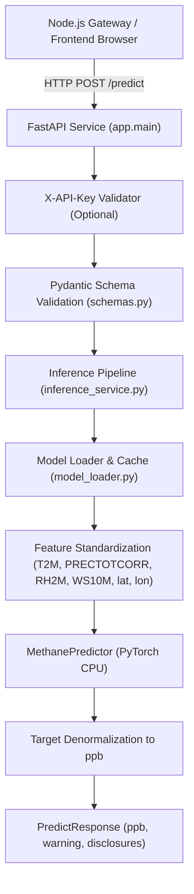

# Earth Systems Trend Detective — ML Inference Microservice
### NASA Space Apps Challenge 2026 — "Be An Earth System Trend Detective!"

Production-grade Python/FastAPI microservice serving the 15 reference Multi-Layer Perceptron (MLP) PyTorch checkpoints across 3 chronological cross-validation folds and 5 Monte Carlo seeds for atmospheric methane ($X\text{CH}_4$) estimation over India.

---

## 1. System Architecture



---

## 2. Key Scientific Disclosures & Limitations

1. **Experimental Baseline Status:** The model is an **experimental reference baseline**. In empirical cross-validation experiments, the cyclical **Month-Only harmonic baseline (MAE 49.039 ppb)** outperformed the trained MLP (MAE 53.786 ppb) and Graph Convolutional Networks (58.479 / 70.934 ppb).
2. **Negative $R^2$ on Spatial Validation:** Spatial validation yields negative $R^2$ scores, indicating that complex local surface fluxes (wetlands, paddy fields, landfills, pipeline infrastructure) cannot be resolved purely by 2° coarse monthly climate variables.
3. **Four Snapshot Pilot:** Sentinel-5P pilot data comprises only 4 observation months (May 2019, Feb 2021, Aug 2021, Nov 2023). Southeast India contains 0 valid soundings due to monsoon optical cloud filtering ($QA \ge 0.50$).
4. **Concentration $\ne$ Emission:** Total dry-air column mole fraction ($X\text{CH}_4$ in ppb) reflects atmospheric advection and transport; it must **never** be interpreted as direct surface emissions flux without inverse transport modeling.

---

## 3. Local Installation & Execution

### Prerequisites
- Python 3.10, 3.11, or 3.12 (also compatible with Python 3.14 CPU)
- PyTorch (CPU wheel recommended)

### Quickstart

```bash
# 1. Navigate to the model service directory
cd model-service

# 2. (Optional) Create virtual environment
python -m venv .venv
source .venv/bin/activate  # On Windows: .venv\Scripts\activate

# 3. Install lightweight dependencies
pip install --upgrade pip
pip install torch --index-url https://download.pytorch.org/whl/cpu
pip install -r requirements.txt

# 4. Run tests and verify parity
python tests/run_all_tests.py

# 5. Start the FastAPI development server
uvicorn app.main:app --host 0.0.0.0 --port 8000 --reload
```

---

## 4. API Documentation & Examples

### A. Healthcheck (`GET /health`)
Verifies that all 15 checkpoints are present and PyTorch is active on CPU.

**Response:**
```json
{
  "status": "healthy",
  "service": "Earth Systems Trend Detective - ML Inference Service",
  "version": "1.0.0",
  "python_version": "3.11.9",
  "pytorch_version": "2.2.0+cpu",
  "device": "cpu",
  "checkpoints_found": 15,
  "checkpoints_expected": 15,
  "all_checkpoints_loaded": true,
  "timestamp_utc": "2026-11-14T20:00:00Z"
}
```

### B. Model Metadata (`GET /metadata`)
Returns full architectural specifications, feature ordering, fold normalization parameters, and scientific disclosures.

### C. Single-Sample Inference (`POST /predict`)
Accepts an 8-feature dictionary or flat array.

**Request Payload:**
```json
{
  "fold": 1,
  "seed": 42,
  "features": {
    "T2M": 26.5,
    "PRECTOTCORR": 4.2,
    "RH2M": 65.0,
    "WS10M": 3.1,
    "latitude": 23.0,
    "longitude": 83.0,
    "month_sin": 0.5,
    "month_cos": 0.866
  }
}
```

*Note: Alternatively, you can provide `"month": 7` (July) and the service will automatically compute harmonic sine and cosine encodings.*

**Response Payload:**
```json
{
  "prediction_ppb": 1846.0133,
  "output_unit": "ppb",
  "model": "Original MLP Reference Model",
  "fold": 1,
  "seed": 42,
  "status": "experimental_reference",
  "input_features": {
    "T2M": 26.5,
    "PRECTOTCORR": 4.2,
    "RH2M": 65.0,
    "WS10M": 3.1,
    "latitude": 23.0,
    "longitude": 83.0,
    "month_sin": 0.5,
    "month_cos": 0.866
  },
  "scientific_warning": "Not validated for operational methane forecasting. Interpret strictly within the original pilot-data scope.",
  "scientific_disclosure": "Notice: In empirical evaluations, the cyclical Month-Only baseline (MAE 49.039 ppb) outperformed the trained MLP (MAE 53.786 ppb)..."
}
```

### D. Vectorized Batch Inference (`POST /predict/batch`)
Accepts up to 1,000 samples for matrix evaluation.

---

## 5. Dockerization

Build and run the lightweight containerized service:

```bash
# Build image
docker build -t earth-trend-ml-service:latest -f Dockerfile .

# Run container
docker run -d --name ml-service -p 8000:8000 earth-trend-ml-service:latest

# Probe health
curl -f http://localhost:8000/health
```

---

## 6. Render Deployment Guide

1. Log into [Render.com](https://render.com).
2. Create a new **Web Service** and connect repository `https://github.com/Piyush9940/thirdeye.git`.
3. Configure settings:
   - **Root Directory:** `model-service`
   - **Environment:** `Python`
   - **Build Command:** `pip install --upgrade pip && pip install torch --index-url https://download.pytorch.org/whl/cpu && pip install -r requirements.txt`
   - **Start Command:** `uvicorn app.main:app --host 0.0.0.0 --port $PORT --workers 2`
   - **Health Check Path:** `/health`
   - **Plan:** Free (or Starter, 512 MB RAM is sufficient as CPU checkpoints are only 63 KB total).
4. Add Environment Variables:
   - `INFERENCE_DEVICE`: `cpu`
   - `ENVIRONMENT`: `production`
   - `MODEL_PACKAGE_DIR`: `./models/production_reference`
5. Click **Deploy Web Service**.
6. Once deployed, note your service URL (e.g., `https://earth-trend-ml.onrender.com`).
7. Update the Node.js backend `.env`:
   ```dotenv
   MODEL_SERVICE_URL=https://earth-trend-ml.onrender.com
   ```

### Redeployment without Retraining
To modify API routes, validation rules, or logging in `model-service/`, commit and push changes to GitHub. Render automatically triggers a zero-downtime rebuild and redeploy without altering or retraining the model weights.
